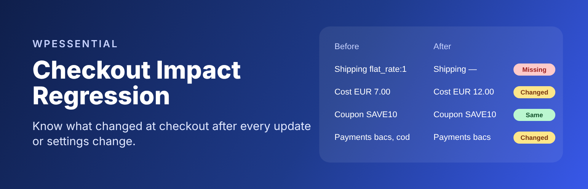
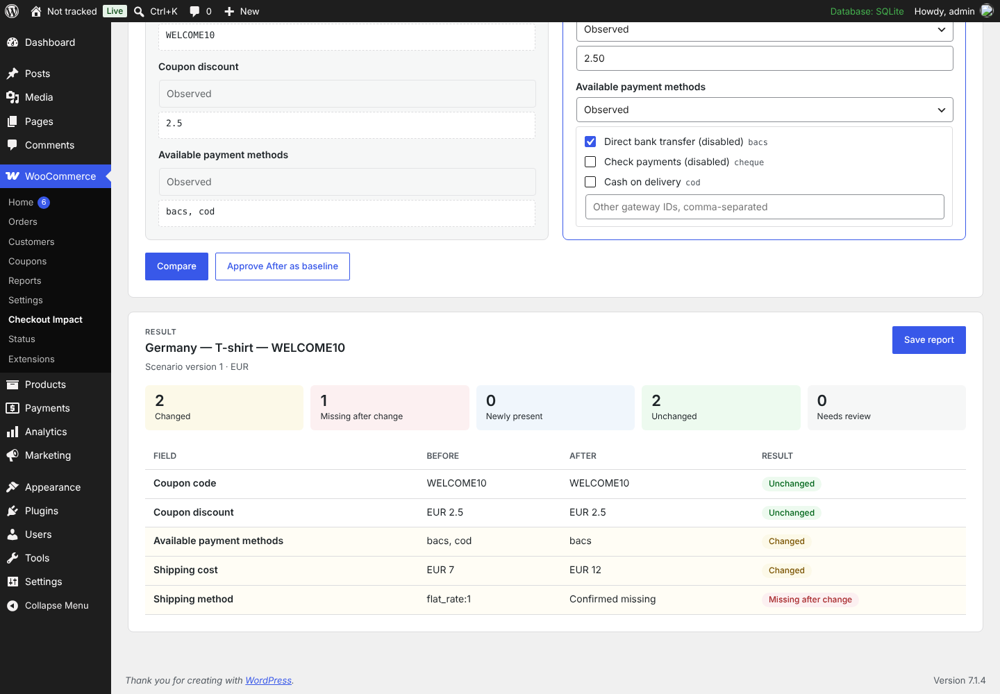
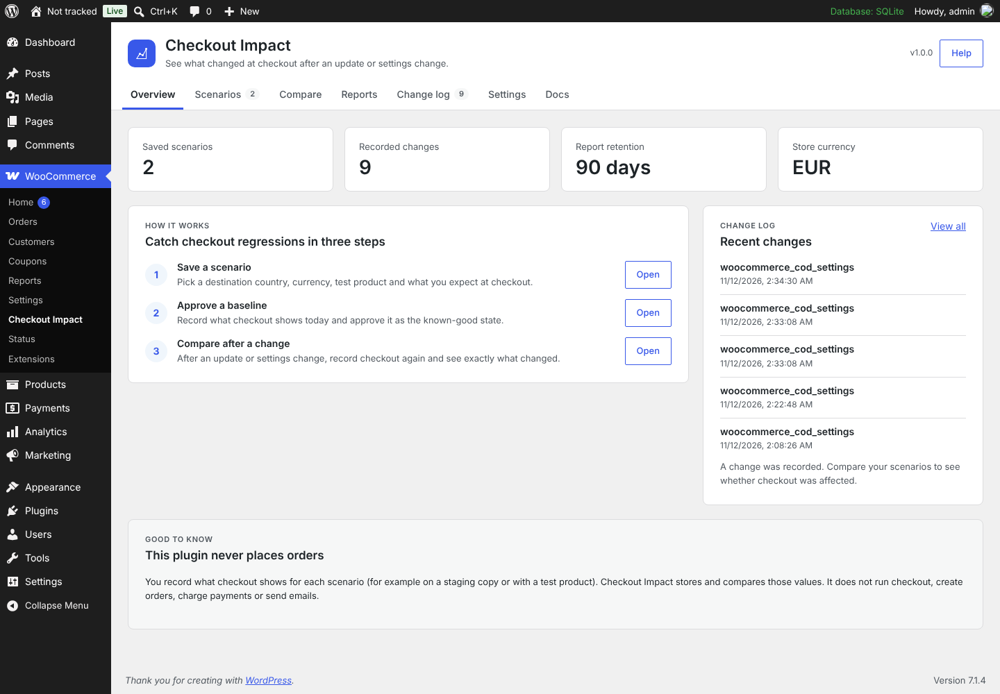
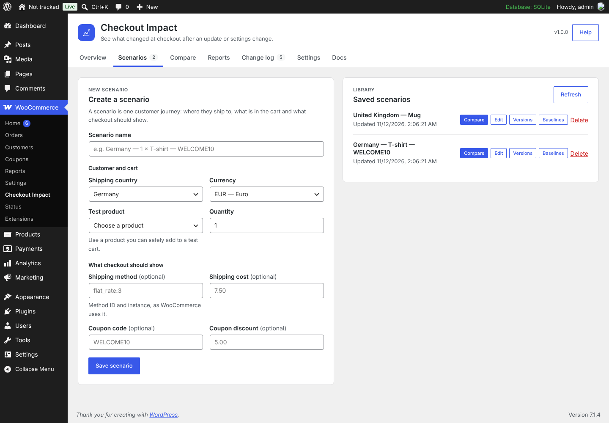
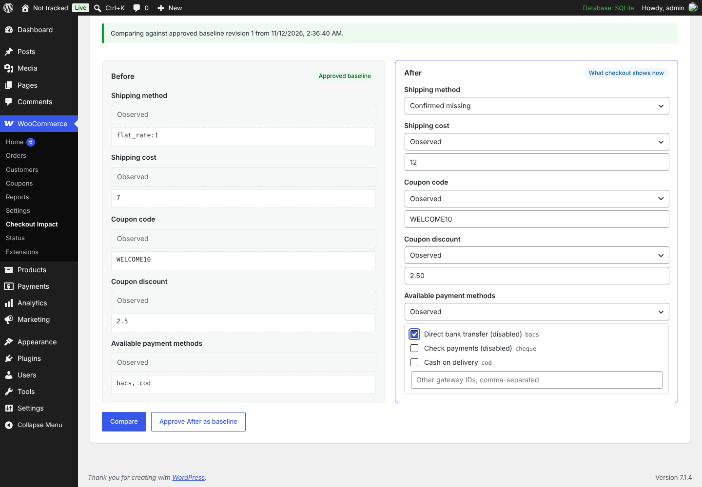
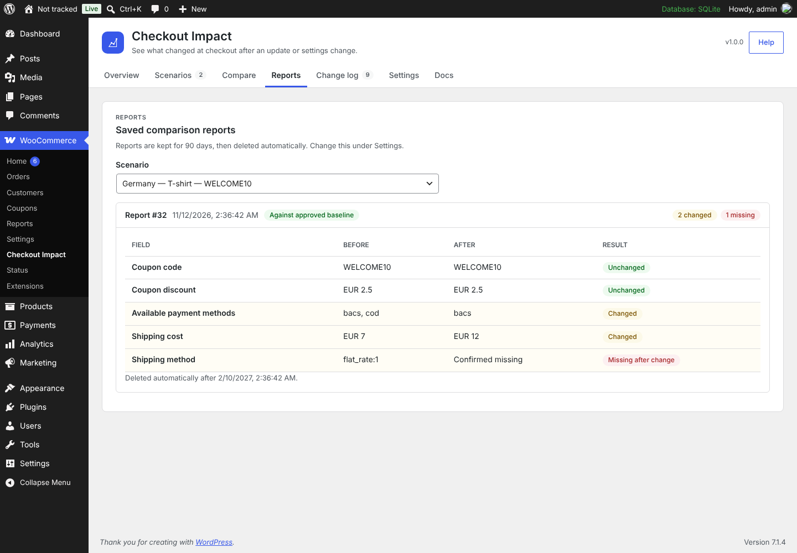
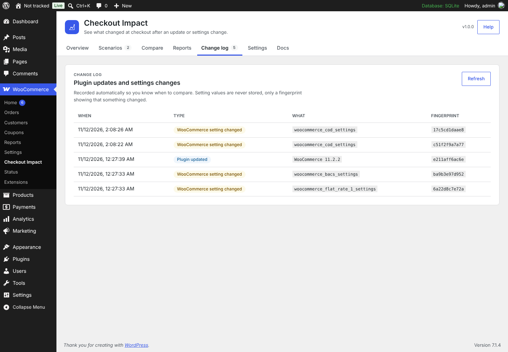
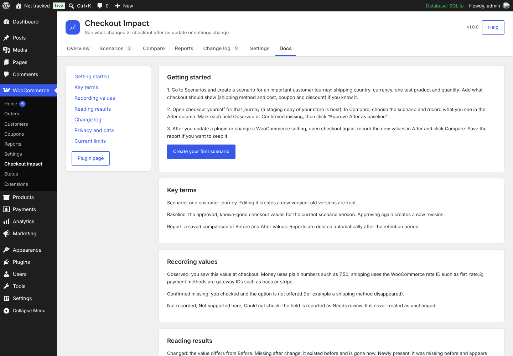

<p align="center">
  
</p>

<h1 align="center">Checkout Impact Regression for WooCommerce</h1>

<p align="center">
  See what changed at checkout after a plugin update or settings change.
</p>

<p align="center">
  <a href="https://github.com/Vertex-Systems-Network/checkout-impact-regression-for-woocommerce/actions/workflows/ci.yml"></a>
  
  
  
  
  <a href="LICENSE"></a>
</p>

<p align="center">
  <a href="https://wpessential.org/plugins/checkout-impact-regression-for-woocommerce">Plugin page</a> ·
  <a href="https://github.com/Vertex-Systems-Network/checkout-impact-regression-for-woocommerce/wiki">Documentation</a> ·
  <a href="https://github.com/Vertex-Systems-Network/checkout-impact-regression-for-woocommerce/issues">Report a bug</a> ·
  by <a href="https://wpessential.org">WPEssential</a>
</p>

---

A plugin update or a small change to a shipping zone or payment gateway can quietly change what customers see at checkout. A shipping method disappears, a rate goes up, a coupon stops applying, or a payment method is no longer offered. Most store owners find out from a customer.

**Checkout Impact Regression for WooCommerce** gives you a simple before-and-after check for the checkout journeys that matter most. Save a scenario, approve a known-good baseline, and after any change see field by field what is different.

> **Example:** after updating a shipping plugin, the *Germany – best seller* scenario shows shipping method `flat_rate:1 → missing`, shipping cost `EUR 7.00 → EUR 12.00`, coupon unchanged.

The plugin never places orders, charges payments, emails customers or runs checkout for you. You record what checkout shows, ideally on a staging copy of your store, and the plugin stores and compares it.

<p align="center">
  
</p>

## Contents

- [How it works](#how-it-works)
- [Features](#features)
- [Free and Pro](#free-and-pro)
- [Requirements](#requirements)
- [Installation](#installation)
- [Quick start](#quick-start)
- [Screenshots](#screenshots)
- [Privacy and safety](#privacy-and-safety)
- [Documentation](#documentation)
- [For developers](#for-developers)
- [Project status](#project-status)
- [Contributing and support](#contributing-and-support)
- [License](#license)

## How it works

1. **Save a scenario.** Describe a customer journey: shipping country, currency, a test product and quantity, and what checkout should show (shipping method and cost, coupon and discount).
2. **Approve a baseline.** Open checkout for that journey, record what you see and approve it as the known-good state.
3. **Compare after a change.** After an update or a settings change, record checkout again. The plugin shows which fields changed, disappeared, appeared or need review.

## Features

- **Scenario library with version history.** Editing a scenario creates a new version; old versions are kept.
- **Approved baselines.** Each baseline is tied to the exact scenario version it was approved for.
- **Field-by-field comparison** of shipping method, shipping cost, coupon code, coupon discount and available payment methods.
- **Honest results.** A value you did not record is reported as *Needs review*, never as unchanged.
- **Exact money comparison** in the scenario currency, with no floating-point rounding.
- **Saved reports** that are deleted automatically after 7–365 days (30 by default).
- **Change log** of plugin updates and changes to WooCommerce payment and shipping settings, so you know when to compare. Setting values are never stored.
- **Store-aware pickers** for countries, currencies, products, shipping rates and payment gateways.
- **Built-in documentation** under *WooCommerce → Checkout Impact → Docs*.
- **Compatible** with High-Performance Order Storage (HPOS) and the Cart and Checkout blocks. The plugin does not read or change orders and adds nothing to the storefront.

## Free and Pro

| | Free | Pro add-on |
|---|:---:|:---:|
| Scenarios, versions and approved baselines | ✓ | ✓ |
| Before/after comparison and saved reports | ✓ | ✓ |
| Change log of plugin updates and settings changes | ✓ | ✓ |
| Retention, data removal and WordPress privacy tools | ✓ | ✓ |
| In-plugin documentation | ✓ | ✓ |
| Email alerts when a checkout-related change is recorded | | ✓ |
| CSV / JSON export of reports | | ✓ |

The free plugin is complete on its own: no locked features, trials or upsell notices. **Checkout Impact Regression Pro for WooCommerce** is a separate paid plugin, to be sold on the WooCommerce Marketplace. It needs this plugin installed and active, and WordPress will not activate it otherwise. This repository contains no Pro code.

## Requirements

| | Minimum | Tested up to |
|---|---|---|
| WordPress | 6.9 | 7.1 |
| WooCommerce | 10.8 | 11.2 |
| PHP | 8.2 | 8.4 |
| Database | MySQL/MariaDB or SQLite | Verified on MariaDB 10.11 and SQLite |

Users need the `manage_woocommerce` or `manage_options` capability (Shop managers and Administrators).

## Installation

The plugin is not on WordPress.org yet. Until it is:

1. Download the latest `checkout-impact-regression-for-woocommerce-<version>.zip`. Open the latest successful [CI run](https://github.com/Vertex-Systems-Network/checkout-impact-regression-for-woocommerce/actions/workflows/ci.yml?query=branch%3Amain) and use its **free-plugin-package** artifact, or [build it yourself](#for-developers).
2. In WordPress, make sure **WooCommerce** is installed and active.
3. Go to **Plugins → Add New → Upload Plugin**, choose the ZIP and click **Install Now**.
4. Activate it and open **WooCommerce → Checkout Impact**.

Once it is listed on WordPress.org, install it from **Plugins → Add New** by searching for "Checkout Impact Regression".

## Quick start

1. **Scenarios → Create a scenario.** Pick the shipping country, currency, a test product and quantity. Optionally add what checkout should show. Save.
2. **Open checkout yourself** for that journey, preferably on a staging copy of your store.
3. **Compare tab.** Choose the scenario. In the **After** column record each field as *Observed* (with its value) or *Confirmed missing*, then click **Approve After as baseline**.
4. **Make your change:** update a plugin, edit a shipping zone or switch a gateway.
5. Open checkout again, record the new values and click **Compare**. Click **Save report** to keep the result.

Tip: start with your most important journey, such as your biggest shipping country with your best-selling product. The full walkthrough is in [Getting Started](https://github.com/Vertex-Systems-Network/checkout-impact-regression-for-woocommerce/wiki/Getting-Started).

## Screenshots

| | |
|---|---|
|  **Overview** with the three-step workflow and recent changes |  **Scenario builder** with your store's countries, currencies and products |
|  **Recording** After values against an approved baseline |  **Comparison** of changed, missing and unchanged fields |
|  **Saved reports** with automatic retention |  **Change log** of plugin updates and settings changes |
|  **Built-in documentation** | |

## Privacy and safety

- Nothing is sent to external services: no tracking, no remote scripts, no licence checks.
- Data stays in the plugin's own database tables on your site.
- Values that look like email addresses, passwords, tokens or API keys are rejected.
- Supports the WordPress personal data export and erase tools.
- Deactivating never deletes data. Deleting the plugin keeps data too, unless you turn on **Delete all Checkout Impact data when the plugin is deleted** in Settings.

## Documentation

- **In the plugin:** *WooCommerce → Checkout Impact → Docs*, or the **Documentation** link on the Plugins screen.
- **Wiki:** [Home](https://github.com/Vertex-Systems-Network/checkout-impact-regression-for-woocommerce/wiki) · [Getting Started](https://github.com/Vertex-Systems-Network/checkout-impact-regression-for-woocommerce/wiki/Getting-Started) · [Scenarios](https://github.com/Vertex-Systems-Network/checkout-impact-regression-for-woocommerce/wiki/Scenarios) · [Baselines and Comparison](https://github.com/Vertex-Systems-Network/checkout-impact-regression-for-woocommerce/wiki/Baselines-and-Comparison) · [Reports](https://github.com/Vertex-Systems-Network/checkout-impact-regression-for-woocommerce/wiki/Reports) · [Change Log](https://github.com/Vertex-Systems-Network/checkout-impact-regression-for-woocommerce/wiki/Change-Log) · [Settings and Privacy](https://github.com/Vertex-Systems-Network/checkout-impact-regression-for-woocommerce/wiki/Settings-and-Privacy) · [Pro Add-on](https://github.com/Vertex-Systems-Network/checkout-impact-regression-for-woocommerce/wiki/Pro-Add-on) · [Developer Reference](https://github.com/Vertex-Systems-Network/checkout-impact-regression-for-woocommerce/wiki/Developer-Reference) · [FAQ and Troubleshooting](https://github.com/Vertex-Systems-Network/checkout-impact-regression-for-woocommerce/wiki/FAQ-and-Troubleshooting)
- The wiki is published from [`docs/wiki/`](docs/wiki/Home.md) in this repository. Edit the files there, not the wiki itself.

## For developers

### Build and test

```bash
composer install
for t in tests/php/*-contract.php tests/php/normalizer-diff.php tests/php/multilingual-context-dry-run.php; do php "$t" || exit 1; done
php tests/php/uninstall-contract.php erase
php tools/readme-to-txt.php --check   # readme.txt is generated from wordpress-org/readme.md
./bin/build.sh                        # dist/checkout-impact-regression-for-woocommerce-<version>.zip
```

### Extension points

Add-ons, including Pro, use only these public hooks and APIs:

| Type | Name | Purpose |
|---|---|---|
| Action | `wpecir_loaded` | The plugin has booted; its classes are available |
| Action | `wpecir_change_event_recorded` | A plugin update or settings change was logged |
| Action | `wpecir_manual_report_saved` | A comparison report was saved |
| Action | `wpecir_retention_purge_failed` | Automatic deletion of old reports failed |
| Filter | `wpecir_pro_active` | Lets an add-on announce itself |
| Filter | `wpecir_tracked_option_names` | Add more option names to the change log |
| JS filter | `wpecir.adminTabs` | Add tabs to the admin screen |
| JS filter | `wpecir.reportActions` | Add actions to saved reports |

REST routes live under `wpecir/v1` and require `manage_woocommerce` or `manage_options`. See the [Developer Reference](https://github.com/Vertex-Systems-Network/checkout-impact-regression-for-woocommerce/wiki/Developer-Reference) for details.

### Repository layout

| Path | Contents |
|---|---|
| `checkout-impact-regression-for-woocommerce.php` | Main plugin file |
| `includes/` | PHP classes (admin, REST, storage, comparison) |
| `assets/` | Admin React UI (`wp.element`, no build step) and CSS |
| `wordpress-org/` | WordPress.org readme source, banners, icons, screenshots |
| `docs/wiki/` | Wiki pages (published to the GitHub Wiki) |
| `docs/` | Development plan, release checklists and validation evidence |
| `tests/` | Contract tests and fixtures |
| `bin/build.sh`, `tools/` | Packaging and readme generation |

### Continuous integration

Every push to `main`, every pull request from a branch of this repository, every night and every manual run:

- lints the code and runs the contract tests on PHP 8.2, 8.3 and 8.4;
- runs the official WordPress.org **Plugin Check** on the built package;
- tests the free plugin together with the Pro add-on: Pro's compatibility contract and a WordPress Playground run with the latest WordPress and WooCommerce. This needs the `PRO_REPO_TOKEN` secret, so pull requests from forks skip it.

The **free-plugin-package** artifact of each run contains the installable ZIP. This public repository never builds or uploads Pro files.

## Project status

**Version 1.0.0, release candidate.** Development of the v1.0 scope is complete and tested. Remaining steps are submission to WordPress.org and the WooCommerce Marketplace.

Automatic checkout replay is planned for a later 1.x release. The scope, decisions and progress are tracked in the [development plan](docs/DEVELOPMENT-PLAN.md), and the test evidence in [docs/validation](docs/validation/PHASE-7-TASK-EVIDENCE.md).

## Contributing and support

- **Bugs and ideas:** open an [issue](https://github.com/Vertex-Systems-Network/checkout-impact-regression-for-woocommerce/issues). Please include your WordPress, WooCommerce and PHP versions, and never paste real customer data.
- **Pull requests:** work on a branch, keep changes small, and run the tests above before opening the PR. Edit `wordpress-org/readme.md`, not `readme.txt`. AI assistants should read [AGENTS.md](AGENTS.md) first.
- **Security issues:** please report privately through the [plugin page](https://wpessential.org/plugins/checkout-impact-regression-for-woocommerce) rather than in a public issue.

## License

GPL-2.0-or-later. See [LICENSE](LICENSE).

Made by [WPEssential](https://wpessential.org).
