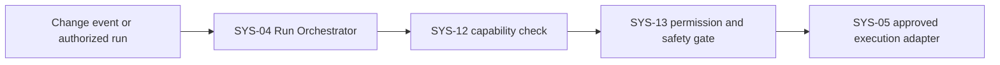
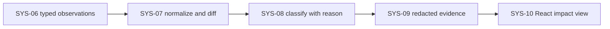

# Proposed architecture and data flow

**Phase:** 3 — Options bank and system architecture  
**Status:** Design proposal complete for planning; no implementation has been validated.  
**Date:** 2026-11-06  
**Related:** [Options bank](../research/OPTIONS-BANK.md) · [System inventory](SYSTEM-INVENTORY.md) · [Requirements](../requirements/REQUIREMENTS.md) · [Integration matrix](INTEGRATION-MATRIX.md) · [Scenario/comparison spec](../design/SCENARIO-AND-COMPARISON-SPEC.md) · [Storage/retention decision proposal](STORAGE-AND-RETENTION-DECISION.md)

## 1. Architecture goals

- Make saved-scenario before/after comparison the primary product behavior.
- Preserve one owner and one source of truth for every accepted option.
- Observe the checkout behavior WooCommerce actually presents for a scenario. External carrier quotes are not a substitute for that observation.
- Keep sensitive data local by default, minimize evidence, and fail closed when safe execution is not proven.
- Keep React presentation separate from PHP-side authorization, orchestration, normalization and classification.
- Expose unsupported, partial, flaky and inconclusive states instead of manufacturing a green result.

## 2. Option-to-owner crosswalk

The owner is the single system accountable for the option's persisted state and acceptance behavior. Cross-cutting systems may enforce policy but do not create a second feature owner.

| Option | Accountable owner | Supporting systems | Disposition |
|---|---|---|---|
| OI-01 Scenario definition | SYS-01 Scenario Catalog | SYS-10, SYS-13 | Core candidate |
| OI-02 Approved baseline | SYS-02 Baseline Registry | SYS-01, SYS-13 | Core candidate |
| OI-03 Scenario execution/rerun | SYS-04 Run Orchestrator | SYS-05, SYS-12, SYS-13 | Core candidate; safe-run proof required |
| OI-04 Checkout observations | SYS-06 Observation Adapter Registry | SYS-05 | Core candidate; per-field support is adapter-specific |
| OI-05 Deterministic field diff | SYS-07 Normalizer & Diff Engine | SYS-02, SYS-06 | Core candidate |
| OI-06 Affected/unchanged impact view | SYS-10 Admin Experience | SYS-08, SYS-09 | Core candidate |
| OI-07 Classification policy | SYS-08 Impact Classifier | SYS-03, SYS-07, SYS-12 | Core candidate |
| OI-08 Change context | SYS-03 Change Context Collector | SYS-04, SYS-12 | Core candidate; only supported sources |
| OI-09 Minimal reproduction evidence | SYS-09 Evidence Store | SYS-13 | Core candidate |
| OI-10 Safe-run enforcement | SYS-13 Privacy & Permission Guard | SYS-04, SYS-05 | P0 blocker; run cannot start unless policy gate passes |
| OI-11 Capability/support checks | SYS-12 Compatibility Registry | SYS-13 | Core candidate; facts require test evidence |
| OI-12 Expected-change/baseline approval | SYS-02 Baseline Registry | SYS-08, SYS-13 | Core candidate; immutable history |
| OI-13 Notifications | SYS-11 Alert Router | SYS-08, SYS-09, SYS-13 | P1 candidate |
| OI-14 React admin experience | SYS-10 Admin Experience | Permission-checked application API | P1 candidate |
| OI-15 Support export | SYS-14 Reporting/Export | SYS-09, SYS-13 | P2 / later |
| OI-16 AI-assisted scenario suggestions | None | None | Deferred; not accepted scope and no architecture dependency |

OI-10's one accountable owner is SYS-13: SYS-04/SYS-05 consume its allow/deny decision, and cannot override it. OI-16 is explicitly deferred, so it is not an accepted option missing an owner.

## 3. Logical data flow

### Change capture and safe run

A failed capability or safety gate ends the run as unsupported/inconclusive before checkout execution. Duplicate triggers resolve to an idempotent run key. A change event records provenance and time; it does not establish causality.

### Observation through impact report

SYS-07 compares only values with compatible scenario, currency, tax, checkout-mode and adapter context. SYS-10 receives a typed application response; the browser never owns permission checks or impact rules. SYS-11 may receive a finding only after policy says it is material and notification is enabled.

## 4. Domain records and ownership

These are conceptual contracts. Phase 4 must define exact schema, field optionality, versioning and tolerances before persistence is implemented.

| Record | Owner | Required conceptual fields | Invariants |
|---|---|---|---|
| ScenarioVersion | SYS-01 | scenario ID/version, synthetic cart, region attributes, currency/language, coupon/assertions, checkout mode, creator/time | Versioned inputs; no card credentials or real shopper profile by default. |
| BaselineVersion | SYS-02 | baseline ID/version, scenario version, normalized expected fields, environment fingerprint, approver/time | Immutable after approval; cannot compare mismatched context as a valid pass. |
| ChangeEvent | SYS-03 | source/type, component or setting reference, before/after version/hash where safe, timestamp, provenance | Secret values excluded; temporal relationship is not causal proof. |
| Run | SYS-04 | run ID/idempotency key, scenario/baseline versions, trigger, environment/capabilities, state/timestamps, runner version | Bounded lifecycle; retries capped; every requested scenario receives a terminal status. |
| Observation | SYS-06 | stable field ID, typed value, unit/currency/tax context, adapter/source/version, observation time, collection status | Missing, unsupported, not-observed and failed are distinct. |
| Difference | SYS-07 | baseline/run/scenario refs, field ID, expected/observed/delta, normalization schema | Deterministic calculation; incompatible values are skipped with an explanation. |
| Finding | SYS-08 | difference refs, classification, severity/confidence, reason code, related change-event refs | Unknown is never mapped to unchanged; correlation is labeled as correlation. |
| EvidenceRef | SYS-09 | run/finding refs, artifact type, redaction state, retention and access metadata | Store only necessary evidence; no secrets; policy-controlled access and deletion. |
| ReviewAction | SYS-02 | actor, time, finding/baseline refs, action, reason | Approval/acknowledgement is explicit and auditable; prior versions survive. |

**Storage decision gate:** the [storage/retention decision](STORAGE-AND-RETENTION-DECISION.md) records the accepted planning choice of versioned per-site custom tables for relational history and non-autoloaded options for small configuration. Exact-version migration, privacy and retention runtime proof remains mandatory before implementation. Do not store growing run histories in autoloaded options.

## 5. Proposed decision records

| ID | Decision | Status | Rationale / consequence |
|---|---|---|---|
| ADR-001 | Local-first processing; no cloud transmission by default. | Proposed | Reduces data movement and avoids inventing a hosted dependency. Any future service needs explicit consent, data-flow/security review and a separate decision. |
| ADR-002 | WooCommerce's actual registered checkout methods/results are the primary comparison source; direct carrier APIs are optional supporting adapters only. | Proposed | A carrier quote may differ from the rate a shopper sees after store rules, extensions, packaging and discounts. Do not report a provider quote as checkout behavior. |
| ADR-003 | One normalized observation/diff pipeline owns comparison semantics; adapters only capture values and provenance. | Proposed | Avoids duplicated comparison logic and lets unsupported fields remain explicit. |
| ADR-004 | React is a presentation client; WordPress/PHP application services own authorization, validation, state changes and classification. | Proposed | Fits WordPress admin while protecting business rules from client-side bypass. |
| ADR-005 | Scenarios and approved baselines are versioned; a new run never silently replaces either. | Proposed | Preserves explainable before/after comparisons and an audit trail. |
| ADR-006 | Safe execution fails closed; no production payment or unbounded checkout side effects. | Required gate | A safe replay mechanism is not proven. No runner implementation can bypass the Phase 6 spike. |
| ADR-007 | Background execution is required for scenario suites; queue technology is undecided. | Open | Compare Action Scheduler/WP-Cron and hosting constraints in a technical spike; ensure bounded retries, idempotency, cancellation and observability. |

## 6. Boundaries and known failure behavior

- **Store API checkout is not a read-only probe.** WooCommerce documents that checkout GET creates a draft order and checkout POST processes an order/payment. Cart address, coupon and shipping-rate operations also mutate the cart/session. Follow the no-submit, isolated-session rules in the [scenario/comparison specification](../design/SCENARIO-AND-COMPARISON-SPEC.md); do not use checkout endpoints for passive observation.

- Woo checkout rate/gateway unavailable: capture the absence only when the checkout mode/adapter is verified; otherwise unsupported.
- Carrier API timeout or quote change: record as provider diagnostic evidence, not a confirmed customer-facing checkout regression.
- Currency/tax/locale or checkout-mode mismatch: do not calculate a numeric delta; report context mismatch/inconclusive.
- Missing change history: show history gap; manual run remains distinguishable from an update-triggered run.
- Partial adapter data: compare compatible fields and show skipped fields.
- Privacy/safety gate denial: no execution; tell the user which requirement failed without exposing secrets.
- Queue retry exhaustion: terminal execution-failure state; never show unchanged.
- Alert failure: finding remains in the report and delivery failure is separate.
- Unauthorized baseline approval/export: reject server-side even if the UI action is hidden.

## 7. Critical unknowns and validation plan

| Unknown | Owner task | Evidence needed / phase |
|---|---|---|
| Can checkout be observed repeatably without a real payment, unintended order, customer email, inventory/webhook/fulfillment side effect? | SPIKE-001 | Phase 6; prove prevention/containment for each supported checkout mode or reject the mode. |
| Which core/plugin settings changes are observable with a safe, secret-free event record? | ARCH-002 follow-up | Phase 6; hook/API spike and change-source coverage table. |
| Which result fields are stable across classic checkout and Checkout Blocks? | ARCH-003 / SPIKE-001 | Phase 4 schemas then Phase 6 test evidence. |
| What queue works reliably across typical hosts and WP-Cron constraints? | ARCH-002 follow-up | Phase 6 scheduling spike. |
| What storage model meets volume, migration and privacy lifecycle needs? | ARCH-002 follow-up | Phase 4 domain/schema design; Phase 6 migration proof. |
| Which direct provider integrations have business value beyond existing Woo extensions? | ARCH-001 | User validation; provider onboarding/sandbox evidence; separate prioritization. |

## Completion boundary

The Phase 3 planning deliverables define unique option ownership, proposed architecture boundaries, data contracts, data flow, initial decision records, integration research and critical validation tasks. These decisions are planning proposals where marked; implementation choices remain subject to the listed proof and user-validation gates.
